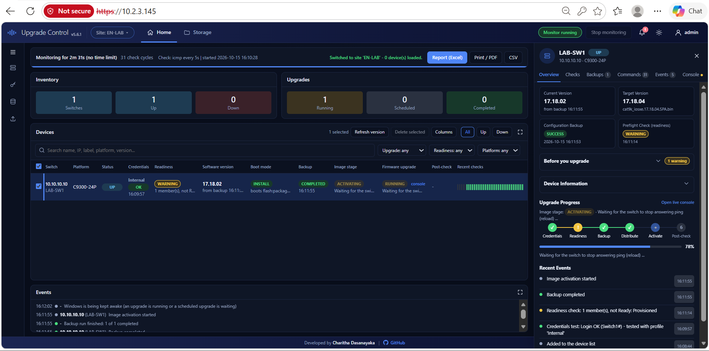

# IOS-XE Upgrade Manager

IOS-XE Upgrade Manager is a Windows desktop application for monitoring Cisco Catalyst switches, managing device inventories, collecting configuration backups, and running or scheduling IOS-XE upgrades. The desktop launcher runs in the Windows notification area and opens a local web dashboard.

The current application version is **5.6.1**. The upgrade workflow is designed for Cisco Catalyst 9200/9300 switches and uses IOS-XE INSTALL mode.

## Screenshots

### Dashboard and live upgrade console

The dashboard shows switch availability, backup and upgrade state, events, and live worker output.



## Features

- Monitor switch availability using ICMP or a TCP connection.
- Organize devices into site profiles and import inventories from Excel workbooks.
- Test and manage device credentials.
- Back up running configuration, version, boot, inventory, and optional additional commands.
- Run readiness checks before upgrading, distribute IOS-XE images, activate upgrades, and verify the version after reload.
- Verify an optional `<image>.bin.sha256` sidecar before scheduling or starting an upgrade; use the digest published by Cisco.
- Start upgrades immediately or schedule them for a later date and time; view each worker's live progress in the dashboard.
- Review device events, backups, and per-device command history. Command logs record commands and results metadata, not switch command output.
- Use role-based dashboard accounts, access controls, and optional HTTPS from the desktop launcher.
- Run the interactive command-line upgrade flow with `--cli`.

## Requirements

- Windows 10 or later for the desktop launcher.
- Python 3.10 or later to run from source or build the executable.
- Network reachability to the switches and SSH credentials with the privileges required for backups and upgrades.
- An Excel workbook (`.xlsx`) when importing a switch inventory.

## Run from source

Install the application dependencies in PowerShell:

```powershell
py -m pip install netmiko openpyxl psutil pystray pillow cryptography
```

Start the desktop launcher:

```powershell
py launcher.py
```

The launcher runs in the notification area. On first start, create the administrator account, then open the dashboard from the launcher. The dashboard uses HTTPS by default; its configured address and port are shown in the launcher.

To start the manager directly without the desktop launcher:

```powershell
py ios_xe_upgrade_manager.py
```

Open `http://127.0.0.1:8080` in a browser when using the direct manager defaults. To seed a site profile from a workbook:

```powershell
py ios_xe_upgrade_manager.py switches.xlsx --site SiteName
```

The workbook's first sheet must have a header row with an `ip` column. Optional columns include `hostname`, `platform`, and `type`. A workbook supplied without `--site` is not imported automatically; inventories can also be uploaded or entered through the dashboard.

### Interactive CLI upgrade

Run the interactive whole-inventory upgrade flow:

```powershell
py launcher.py --cli
```

The CLI prompts for the inventory, credentials, and image, then upgrades eligible switches in parallel.

### Direct manager options

```powershell
py ios_xe_upgrade_manager.py --help
```

For example, use TCP checks when ICMP is blocked, set a custom dashboard port, or open the dashboard automatically:

```powershell
py ios_xe_upgrade_manager.py --mode tcp --port 22 --web-port 9000 --open
```

Monitoring starts when requested from the dashboard. The direct manager listens on `127.0.0.1` by default. Binding to a non-local address requires `--allow-remote`; only enable remote access on a trusted network.

## Build the Windows executable

Install PyInstaller and the application dependencies, then build the launcher:

```powershell
py -m pip install pyinstaller netmiko openpyxl psutil pystray pillow cryptography
py -m PyInstaller --noconsole --onefile --name IOSXEUpgradeManager --icon app.ico --add-data "app.ico;." --hidden-import ios_xe_upgrade_manager --collect-all netmiko --collect-all cryptography launcher.py
```

The executable is created at `dist\IOSXEUpgradeManager.exe`. Keep `ios_xe_upgrade_manager.py` available to the build process; the launcher packages it as a hidden import and invokes its worker mode for device upgrades.

## Security and local data

The desktop launcher supports administrator, operator, and viewer roles, an administrator-managed user list, allowed-client controls, and optional HTTPS. Protect administrator credentials and restrict access to trusted networks. The manager can issue privileged commands that change switch software.

Application settings, audit logs, application logs, and TLS files are stored under:

```text
%LOCALAPPDATA%\IOSXEUpgradeManager
```

The direct manager defaults to loopback. Enabling remote access exposes switch-management capabilities to reachable clients, so configure authentication and network restrictions appropriately when using the launcher.

This application can run privileged commands that change network software. Use it in a controlled pilot until it has been reviewed and validated for your environment. See [SECURITY.md](SECURITY.md) for a deployment baseline and [PRODUCTION_READINESS.md](PRODUCTION_READINESS.md) for the engineering and operational gates that remain before fleet-wide production use.

For an additional local image-integrity check, place the Cisco-published SHA-256 digest in a text file named `<image filename>.sha256` beside the `.bin` image (for example, `cat9k_iosxe.bin.sha256`). The first token must be the 64-character hexadecimal digest. If the sidecar exists, a malformed file or digest mismatch blocks the upgrade. This check is optional for compatibility; it does not authenticate a digest copied from an untrusted source.

## Project files

- `launcher.py` — Windows desktop launcher, tray controls, dashboard access management, and packaged-app entry point.
- `ios_xe_upgrade_manager.py` — dashboard server, device monitoring, backups, upgrade workers, scheduling, and CLI implementation.
- `Dashboardview.png` — application dashboard screenshot shown above.
- `app.ico` — application icon used by the launcher and executable build.
- `.github/workflows/ci.yml` — continuous integration workflow.
